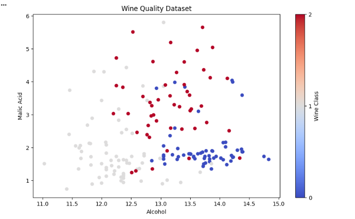
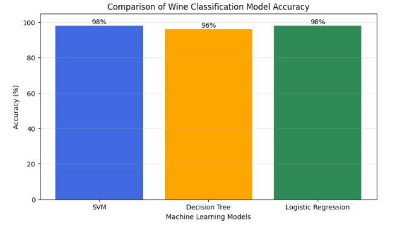
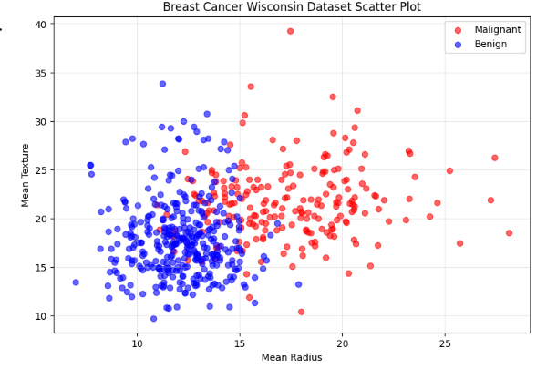
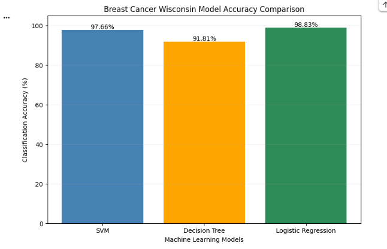
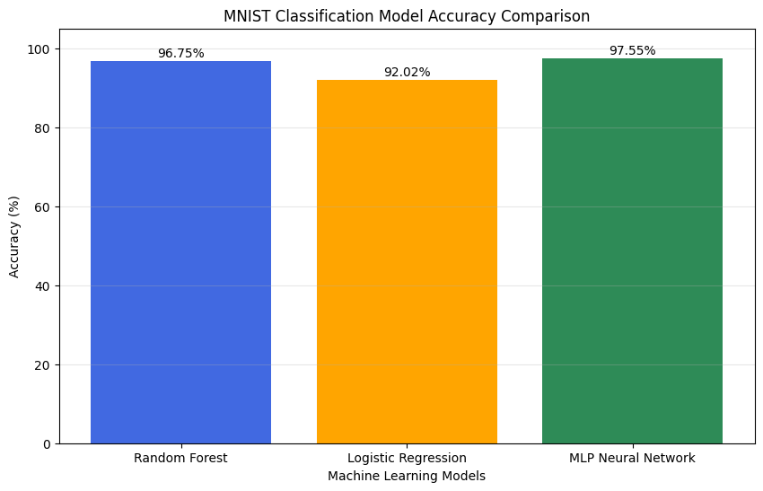
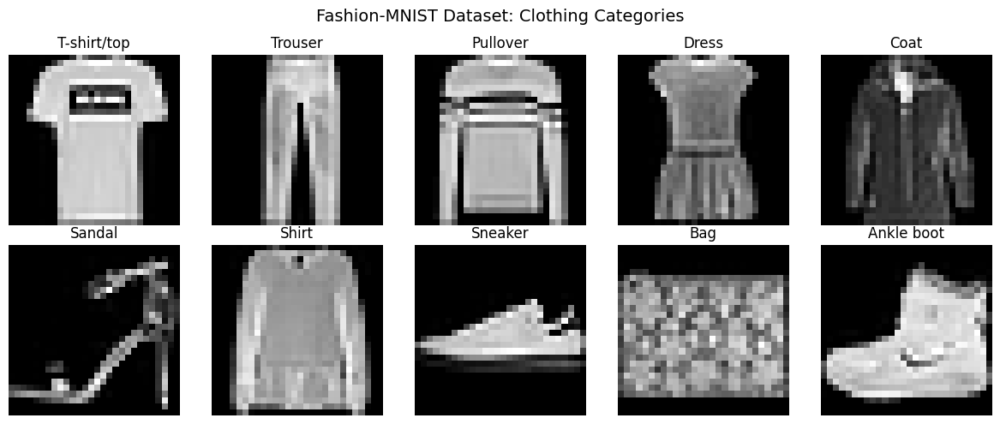
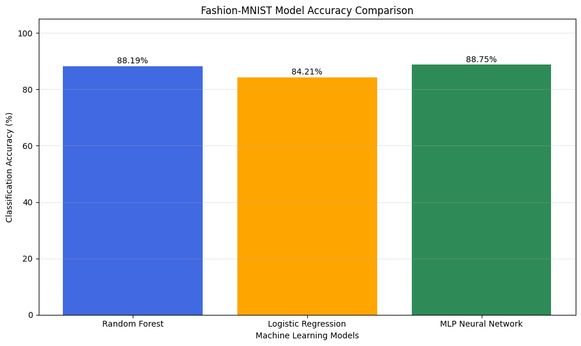

# NANO706 — Assignment 2

## Exercise 2, Part 1: Wine Classification

### Project Overview

This exercise uses machine learning to classify wine samples based on their chemical characteristics. Three classification models were evaluated: Support Vector Machine (SVM), Decision Tree, and Logistic Regression.

The goal was to visualize the dataset, train the classification models, evaluate their accuracy, and compare their performance.

### Dataset Visualization

The Wine dataset contains three wine classes and multiple chemical features. A scatter plot was created to examine the relationship between alcohol content and malic acid.

**Results:** The scatter plot shows some separation between the three wine classes, although several samples overlap. This suggests that alcohol and malic acid provide useful information for classification, but additional chemical features can help distinguish the classes.

### Data Preprocessing and Testing

The dataset was divided into training and testing sets using a 70/30 split with `random_state=42`.

Standardization was performed after splitting the dataset. The scaler was fitted using only the training data and then applied to the testing data to prevent data leakage.

Each classification model was trained using the training set and evaluated using the testing set.

### Machine Learning Model Results

| Model | Test Accuracy |
|---|---|
| Support Vector Machine (SVM) | 98% |
| Decision Tree | 96% |
| Logistic Regression | 98% |

### Model Accuracy Comparison

**Results:** SVM and Logistic Regression achieved the highest accuracy at 98%, while Decision Tree achieved 96%.

All three models demonstrated strong classification performance. The results indicate that the Wine dataset's chemical features are useful for distinguishing between the three wine classes.

### Conclusion

This exercise demonstrated how machine-learning algorithms can classify samples using chemical measurements. SVM and Logistic Regression performed slightly better than Decision Tree on the selected test set. Correct preprocessing helped ensure that the testing data did not influence the standardization of the training data.
## Exercise 2, Part 1: Breast Cancer Wisconsin Classification

### Project Overview

The Breast Cancer Wisconsin Diagnostic dataset was used as an additional dataset to apply and compare machine-learning classification models. The goal was to classify breast tissue samples as malignant or benign based on numerical measurements of cell nuclei.

### Dataset Visualization

The dataset contains 569 samples and 30 numerical features. A scatter plot was created to visualize the relationship between mean radius and mean texture for malignant and benign samples.

**Results:** The scatter plot shows differences between malignant and benign samples, although some overlap is present. This indicates that mean radius and mean texture provide useful classification information, but additional features are important for distinguishing the two classes.

### Data Preprocessing and Testing

The dataset was divided into 70% training data (398 samples) and 30% testing data (171 samples), using `random_state=42` and stratified sampling.

StandardScaler was fitted only on the training data and then applied to the testing data to prevent data leakage.

### Machine Learning Model Results

| Model | Test Accuracy |
|---|---|
| Support Vector Machine (SVM) | 98.25% |
| Decision Tree | 91.81% |
| Logistic Regression | 98.83% |

### Model Accuracy Comparison

**Results:** Logistic Regression achieved the highest accuracy at 98.83%, followed closely by SVM at 98.25%. Decision Tree achieved 91.81%, making it the lowest-performing model of the three.

### Conclusion

The Breast Cancer Wisconsin dataset demonstrated how machine-learning algorithms can classify biological samples using numerical features. Logistic Regression and SVM achieved strong performance in distinguishing malignant and benign samples, while Decision Tree performed slightly less accurately.

This exercise provided experience in dataset preprocessing, classification, model comparison, and interpretation of biological data. Additional validation would be required before considering clinical applications.

## Exercise 2, Part 2: MNIST Classification and YOLO Object Detection

### Project Overview

This exercise explores two applications of machine learning: handwritten-digit classification using the MNIST dataset and object detection using YOLOv5.

### Part A: MNIST Handwritten-Digit Classification

The MNIST dataset contains 70,000 images of handwritten digits ranging from 0 to 9. Three machine-learning models were trained and evaluated to compare their ability to classify handwritten digits.

The models included Random Forest, Logistic Regression, and a Multilayer Perceptron (MLP) Neural Network.

### MNIST Classification Results

| Model | Test Accuracy |
|---|---|
| Random Forest | 96.75% |
| Logistic Regression | 92.02% |
| MLP Neural Network | 97.55% |

### MNIST Accuracy Comparison

**Results:** The MLP Neural Network achieved the highest classification accuracy at 97.55%, followed by Random Forest at 96.75% and Logistic Regression at 92.02%.

These results demonstrate that all three models performed well in recognizing handwritten digits. The MLP Neural Network achieved the strongest performance on the test dataset.

### Part A-2: Fashion-MNIST Classification (New Dataset)

#### Project Overview

The Fashion-MNIST dataset was used to apply the machine-learning methods from the original MNIST classification exercise to a new dataset. Instead of identifying handwritten digits, the models classified grayscale images of clothing and accessories into 10 categories.

The goal was to compare the classification performance of Random Forest, Logistic Regression, and a Multilayer Perceptron (MLP) Neural Network on the new dataset.

#### Dataset Visualization

Fashion-MNIST contains 70,000 grayscale images, each measuring 28 × 28 pixels. The images represent 10 clothing categories, including shirts, trousers, dresses, sneakers, and bags.

**Results:** The visualization displays one example from each clothing category. Some categories have similar shapes and appearances, making it challenging for classification models to distinguish between them.

#### Data Preprocessing and Testing

The images were converted into 784 numerical features, and pixel values were normalized from 0–255 to 0–1.

The dataset was divided into 80% training data (56,000 images) and 20% testing data (14,000 images), using stratified sampling and `random_state=42`.

Feature standardization was applied to Logistic Regression and the MLP Neural Network, while Random Forest used the normalized pixel values.

#### Machine Learning Model Results

| Model | Test Accuracy |
|---|---|
| Random Forest | 88.19% |
| Logistic Regression | 84.21% |
| MLP Neural Network | 88.75% |

#### Model Accuracy Comparison

**Results:** The MLP Neural Network achieved the highest classification accuracy at 88.75%, followed closely by Random Forest at 88.19%. Logistic Regression achieved the lowest accuracy at 84.21%.

#### Conclusion

This exercise demonstrated how machine-learning models can classify clothing images using pixel-based features. All three models performed reasonably well, with the MLP Neural Network producing the strongest results.

Compared with the original MNIST handwritten-digit classification, the models achieved lower accuracy on Fashion-MNIST. This suggests that recognizing clothing categories may be more challenging for these models, particularly when items have similar visual characteristics.

Overall, applying the original machine-learning methods to a new dataset demonstrated how classification performance can vary depending on the type and complexity of the data.
### Part B: YOLO Object Detection

The YOLOv5 object detection model was used to analyze an uploaded photograph containing a person.

The model successfully detected the person and generated a bounding box around the subject with a confidence score of 0.58 (58%).

### YOLO Detection Results

**Results:** The model successfully identified a person within the uploaded image. The bounding box indicates the detected object's location, while the confidence score represents the model's confidence in that detection.

Although the model detected the person, it did not specifically identify the face because the pretrained YOLOv5 model performs general object detection rather than dedicated facial detection.

### Conclusion

Exercise 2 demonstrated two important applications of machine learning. The MNIST classification task compared three models for recognizing handwritten digits, with the MLP Neural Network achieving the highest accuracy. The YOLO object detection task demonstrated how deep-learning-based computer vision can identify and locate objects within an image.

Together, these exercises provided practical experience in classification, model evaluation, and object detection.
